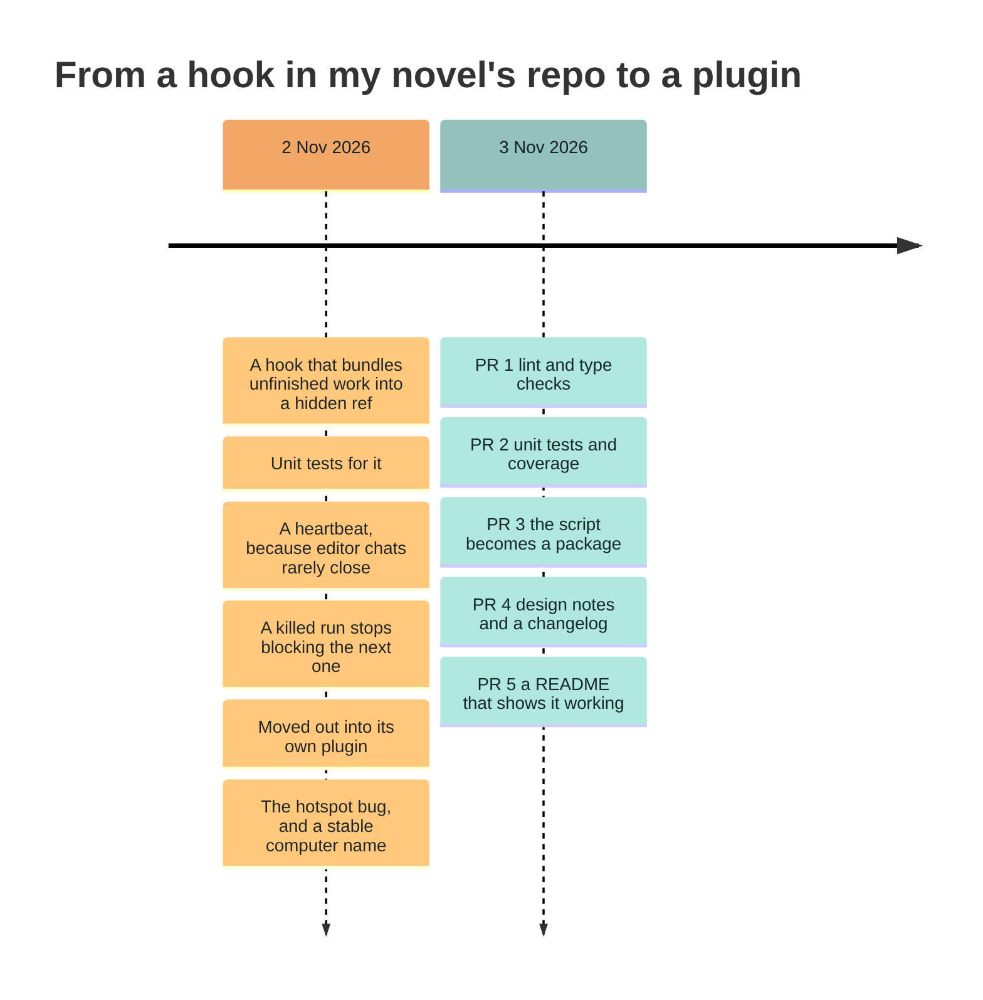
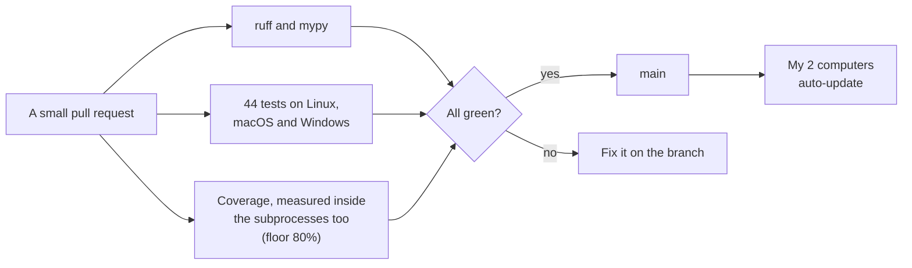
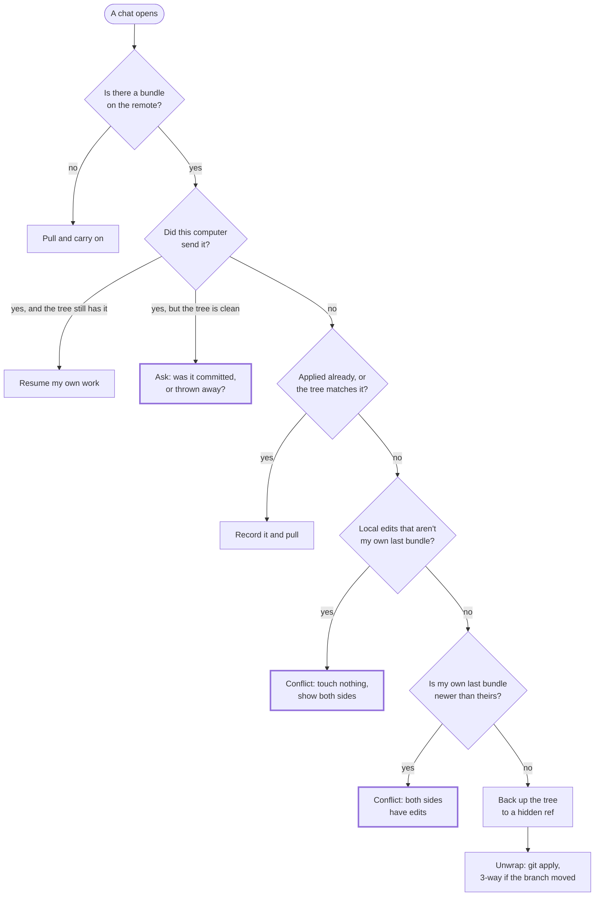
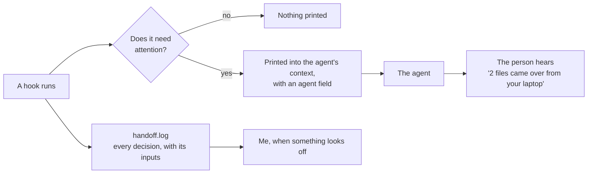
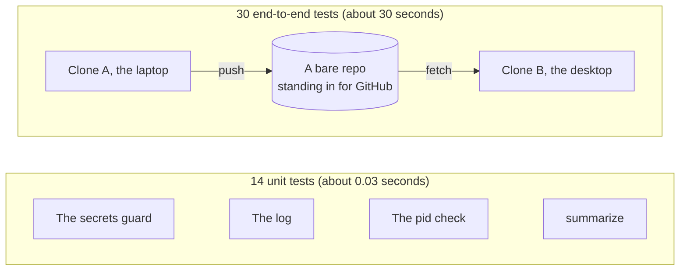
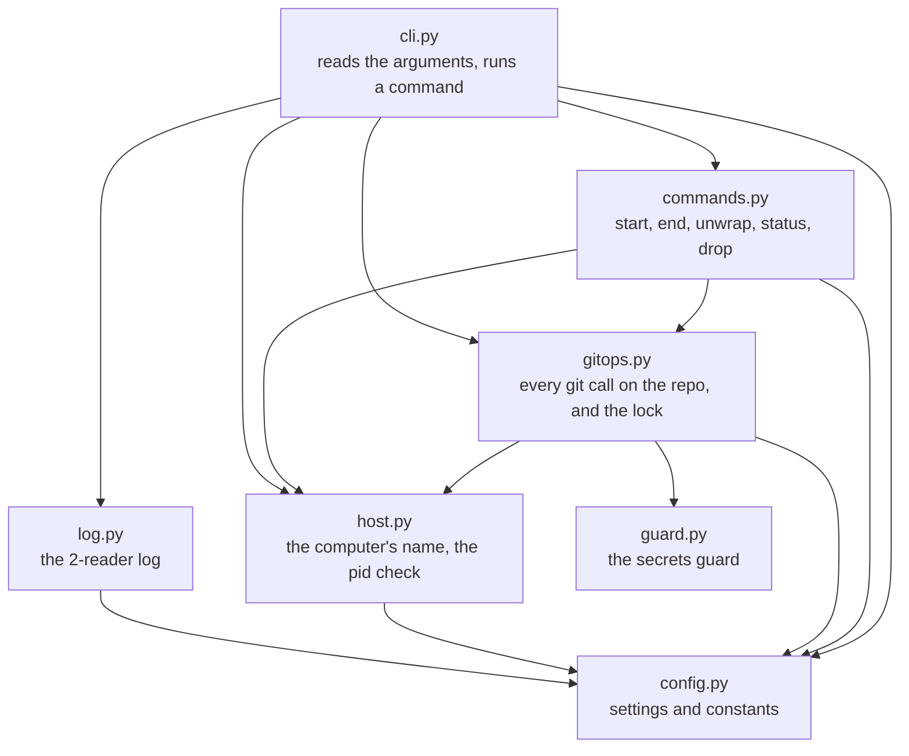
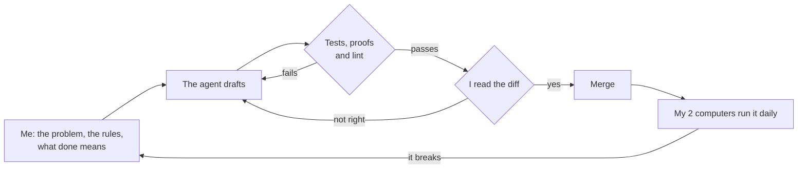

# How I engineer

This repo's tiny - about 1,300 lines of Python - but it's still the one I'd hand you if you asked how I build software. The [build log](building-log.md) goes PR by PR and the [design notes](design.md) go decision by decision. This page is the step back from both, where I just say what I care about as an engineer and point at the spot in this repo where you can check it.

If you want the bigger picture (the novel this came out of, and my day job building AI tooling at a bank), that's in [CreatorLoop](https://github.com/cthleung/CreatorLoop), and its [for-reviewers page](https://github.com/cthleung/CreatorLoop/blob/main/docs/for-reviewers.md) has the work history.

## Where it came from

I write a long novel with AI help, usually with several chats open in the same folder, and I switch between a Mac and a Windows PC. Unfinished work kept getting stuck on whichever computer I'd left it on, but committing unfinished drafts just to move them felt wrong, since a commit's supposed to mean "this is ready." So I wrote a hook that carries the unfinished work across instead.

It started life inside the novel's own repo, and it broke on my real machines a few times that first day, which is honestly where most of its safety rules come from (I wasn't planning on writing any). Once it held up, I moved it out into a plugin, and the next day I went back over it as if I were handing it to a team.

None of that was planned as a portfolio piece. I needed it, and the habits below are really just what I do when I'm going to depend on something.

## 1. I'm the first user, so a bad merge breaks me first

My own 2 computers run this plugin every day, and they update it straight from `main`. That's probably the best test discipline I know, because there's nobody downstream to absorb a mistake (it's my unfinished chapter that gets mangled). So every change goes through the same gate before it merges.

The Windows job doesn't look like much, but it matters. The pid check and the computer-name lookup both have Windows-only code, and `os.kill(pid, 0)`, the usual way to ask "is this process alive?", kills the process on Windows instead of checking it. You only meet that bug by running the real thing on the real OS, so CI does.

## 2. When it isn't sure, it stops and asks

The tool's 1 job is to put files into someone's working tree, which is where their unfinished work lives, so a wrong guess costs a lot more than a pause. It's built on 1 stated assumption - one person on one computer at a time - and anything that doesn't fit gets stopped instead of merged on a guess. This is the decision `start` makes every time a chat opens ([`decide()` in commands.py](../scripts/handoff/commands.py)).

The thick boxes are the places where it refuses to guess. That being said, each one has an explicit way out (`unwrap --force`, which backs up first, or `drop`), so being careful never leaves anyone stuck. And every step that replaces a working tree commits it to `refs/worktree-handoff-backup/<time>` first, which means anything this tool does can be undone with plain git.

## 3. Logs written for 2 readers

The person using this never reads its output directly, but the coding agent does, because whatever a `SessionStart` hook prints goes into the agent's context. So every event gets written twice over, once in full for me and once in short for the agent, and they're really 2 different documents.

The `agent` field is plain instructions ("Nothing was changed. Tell the user before editing: show them the local files, the bundle's files and the overlap..."). **I think of it as an API whose client happens to be a language model, so it gets the same care as any other API.** It's short and specific, and it only shows up when there's something to do. A normal session start prints nothing at all.

## 4. Test the real thing first, then the cheap things

Mocks are cheap, but most of the bugs that matter here live in how the tool talks to git, so the main layer of tests doesn't mock git at all. Each of the 30 end-to-end tests makes 2 throwaway clones and a local bare repo standing in for GitHub, then runs the real entry point, the same file the hooks run, and checks the result with git itself.

The unit tests came later, and they're for the pure pieces that don't need git (does the guard catch a GitHub token? do quiet events stay off the screen?), because paying 30 seconds to check a regex is just silly. Coverage follows the end-to-end tests into their subprocesses, so the 84% is what the tests really reach, and the floor's 80% instead of 100% because the missing lines are the Windows-only ones, which the Windows job runs anyway. I'd rather report an honest 84 than fake the platform to get a prettier number.

## 5. Small modules, each with 1 job, pointing 1 way

The package split ([PR 3](https://github.com/cthleung/worktree-handoff/pull/3)) gave each job its own module, and the imports only ever point down. Nothing near the bottom knows the commands exist.

The unit tests aim at the pieces that never need a repo, which sit near the bottom: `guard`, `log` and `config`, plus the pid check in `host` and `summarize` in `gitops`. And if you're asking "what touches my repo?", the answer's 1 file, `gitops.py` (`host` reads and writes 1 global git config key for the computer's name, and that's it).

## 6. Prove a refactor instead of hoping

Moving 964 lines into 7 modules by hand would've been a great way to lose a line somewhere, so I didn't do it by hand. A small script sliced the old file along its own syntax tree, and afterward I compared the trees, and all 41 functions, classes and constants came out identical to the originals, with `--help` printing the same text. The 30 end-to-end tests also passed without being touched, which is the part I really trust, since they don't even know the package exists.

In other words, I hold behavior changes and refactors to different standards. A behavior change needs a test that fails first. A refactor needs proof that nothing changed, though, and "the tests still pass" only proves it when the tests run the real thing.

## 7. Write down why, including the bug

The [design notes](design.md) give every decision its trade-off, and honestly the most useful section's the embarrassing one. The first version used the network hostname to tell my 2 computers apart, and on a phone hotspot my Mac got a new hostname, stopped recognizing its own bundle and tried to unwrap its own work over itself (the fix is commit `adac36c`). Now the name's picked once and saved in git config. I could've written that section as if the design was right from day 1, but then the next person (me, probably, in a year) would see a strange config key and "simplify" it right back into the bug.

## 8. Boring on purpose

- **No dependencies:** It needs Python 3.10+ and git, and that's it. A plugin that has to pip install on every machine is a plugin that fails on the 1 machine where pip is broken, and I've been that machine.
- **Plain git underneath:** A hidden ref, a scratch index and `git apply` are all stock git, so if the tool ever disappears, everything it left behind still makes sense to someone who knows git.
- **Small PRs:** I'm the only maintainer, so I merge my own, which makes CI the reviewer that can say no. Each one's reviewable in 1 sitting, with its reasoning in the build log right next to the diff. That's how I work at my day job too, several small PRs a day when the work allows, because a change I can review in 1 sitting is a change I'd want to inherit.

## 9. Working with a coding agent

I build with coding agents, mostly Claude Code, and they make plenty of good calls (the `strict=False` in PR 1 was the agent's catch). **The loop I run them in is the same one the rest of this page describes,** and every safety rule in the design notes exists because something broke on my own 2 computers first.

So most of my job on a repo like this is the part the rest of this page is about, which is saying what done means and then checking whether it really is. A few places where the checking paid off:

- **The obvious fix would've crashed:** Ruff asked for an explicit `strict=` on a `zip()`, and `strict=True` is the textbook answer. Here it'd fail on every run, because git's `-z` output always ends in 1 extra empty field, and the end-to-end tests are what would've caught it.
- **The refactor got proof instead of trust:** An agent can move 964 lines and get nearly all of it right, and "nearly" is the problem, which is why PR 3 compared the syntax trees and left the end-to-end tests untouched.
- **The diagrams on this page were wrong at first:** The first draft had the lock in the wrong module and missed that `host.py` calls git, and drawing the graph from the real imports caught both before it went up.
- **Real use caught what the tests couldn't:** The hotspot bug, the killed run that blocked the next one and the chats that never closed all came from me using it, and each one turned into a fix and a test.

I think that's the useful part for anyone building agents for other people. I've spent a lot of time on the user's side of an agent that misreads what I want, and this page is mostly what I do about it.

## The same habits at work

These aren't habits I put on for a portfolio, either. Back in 2023, I was one of the named inventors on a [patent](https://patents.google.com/patent/US12639279B2/en) at the bank (granted in 2026) for an LLM agent that fills in missing documentation for datasets. We split it into small steps you could check on their own, and nothing it wrote counted until a data steward approved it, which is pretty much section 2 and section 9 of this page, years before I wrote either one. I also deployed an NER model for PII detection to GPU inference servers and tuned it 1 variable at a time against a recorded baseline, writing the losing result down as plainly as the win, and I shipped it behind a feature toggle with a fallback to the old path if the new service went down. The full version's on [CreatorLoop's for-reviewers page](https://github.com/cthleung/CreatorLoop/blob/main/docs/for-reviewers.md#shipping-reliable-tested-code).

## What I'd do next

- **Strict mypy:** It runs in its default mode right now, and a lot of the `log` parameters are still untyped (I know, I know). Strict mode would catch more, and it's the next PR I'd write.
- **Bundle order without clocks:** One check compares times from my 2 computers, which is fine while their clocks agree (the [design notes](design.md#which-bundle-is-newer-2-clocks) cover it). Recording which remote bundle each computer last saw would take the clocks out of it.
- **Two people on one branch:** The tool stops and asks when 2 computers both have unsent edits, which is right for 1 person, but it's too cautious for a team. It's doable, but supporting it properly would mean real merge logic, and I'd want a design note before a line of code.
- **A tagged release:** The changelog already says 0.1.0. The tag and the GitHub release are just waiting on me.
